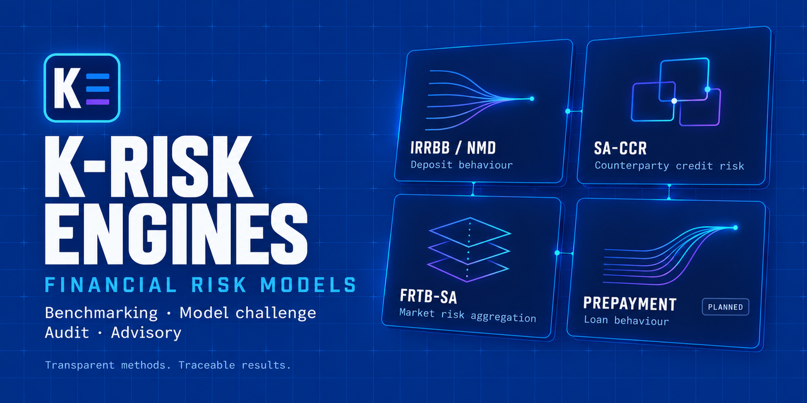

# K-Risk Engines

**Transparent methods. Traceable results.**

[**Visit the website**](https://danielep71.github.io/K-Risk-Engines/) · [**SA-CCR methodology wiki**](https://github.com/danielep71/VBA-SACCR-Toolkit/wiki)

A single entry point to independent financial risk models and calculation engines for benchmarking, model challenge, audit, advisory and education.

 

 

 

## Explore the portfolio

<!-- portfolio:table:start -->
| Project | Purpose | Project-reported status | Last closed milestone |
| --- | --- | --- | --- |
| [K-SACCR](https://github.com/danielep71/VBA-SACCR-Toolkit) | SA-CCR calculation and reconciliation | Version 1.0.1 is the current release: the 1.0.1 GitHub Release carries the workbook and the user manual. Latest published release: v1.0.1. [Full status and caveats](docs/PORTFOLIO_STATUS.md#saccr) | [v1.0.1 - Post release hardening](https://github.com/danielep71/VBA-SACCR-Toolkit/milestone/13) (2026-10-18) |
| [K-IRRBB](https://github.com/danielep71/K-IRRBB-NMDs) | Non-maturity deposit behavioural modelling | v0.2.0 – Workbook, data and Excel tests (in progress). No published stable release. [Full status and caveats](docs/PORTFOLIO_STATUS.md#nmd) | [v0.1.0 - Repository foundation](https://github.com/danielep71/K-IRRBB-NMDs/milestone/1) (2026-10-09) |
| [K-FRTB-SA](https://github.com/danielep71/MKT-FTRB-SA) | Standardized market-risk aggregation | Version 0.1.0 is a prototype of the v0.1.0 — SA prototype milestone (issue #20). No published stable release. [Full status and caveats](docs/PORTFOLIO_STATUS.md#frtb) | [v0.0.1 — Repo setup](https://github.com/danielep71/MKT-FTRB-SA/milestone/1) (2026-10-18) |
| [K-IRRBB Prepayment Models](https://github.com/danielep71/K-IRRBB-Prepayment_Models) | Behavioural loan prepayment modelling | Current status: repository setup only. No published stable release. [Full status and caveats](docs/PORTFOLIO_STATUS.md#prepayment) | None recorded |
<!-- portfolio:table:end -->

Each repository owns its implementation, methodology, tests, issues and releases. Consult it for current scope, evidence and licensing. This hub contains presentation and portfolio documentation, not calculation code.

## Website

The static landing page is `index.html`; images and styles live in [`assets/`](assets/). No build or external dependencies are required.

For GitHub Pages, select **Settings → Pages → Deploy from a branch → main → / (root)**. The live website is [danielep71.github.io/K-Risk-Engines](https://danielep71.github.io/K-Risk-Engines/).

## Website checks

Run `python3 .github/scripts/check-website.py` from the repository root.
Add `--external` to check external URLs with curl.

The dependency-free check covers explicit HTML tag nesting, document title,
language and doctype, duplicate IDs, image alt attributes, local assets,
CSS `url()` references and internal anchors. It is a focused structural
check, not a full HTML standards or accessibility validator.

GitHub Actions runs local checks on every pull request to `main` and push
to `main`. External links are checked on pushes, weekly and on manual runs;
redirects are accepted. Broken links fail the check. Network errors, HTTP
403/429 and server errors are reported as warnings because availability
could not be verified. External page fragments are not validated.

## Daily portfolio refresh

A daily workflow proposes source-attributed status, release and last-closed-milestone updates in a reusable review PR. See [operation and review rules](docs/PORTFOLIO_AUTOMATION.md).

## Traffic history

Daily repository analytics are stored on [`traffic-history`](https://github.com/danielep71/K-Risk-Engines/tree/traffic-history).
See [setup and data definitions](docs/TRAFFIC.md) for the required `analytics`
environment secret, schedules, badges and alerts. This tracks repository traffic,
not GitHub Pages visitors.

## Governance and security

See [portfolio governance](GOVERNANCE.md) for ownership, project status definitions,
change checks and issue handling. Report vulnerabilities privately under the
[security policy](SECURITY.md). For hub defects and improvements, use the
[issue chooser](https://github.com/danielep71/K-Risk-Engines/issues/new/choose).
The maintainer assigns a milestone and confirms the priority during triage.
Engine calculation and methodology reports belong in their own repositories.

## Licensing

The hub's code and documentation are licensed under [MPL-2.0](LICENSE).
The portfolio artwork (`assets/K-Risk-Engines-social-preview.png`) is excluded;
no separate reuse licence is granted for it. See [licensing and attribution](NOTICE.md).
Linked engines retain their own licences.

## Review approach

1. Align data, scope, conventions and assumptions.
2. Compare intermediate calculations and investigate differences.
3. Record versions, reference results, explanations and unresolved limitations.

Agreement with a benchmark supports a review; it does not by itself establish model validity or regulatory compliance.

## Portfolio direction

Develop the existing projects on their own validation evidence, develop the new prepayment project, and maintain consistent presentation and documentation across the collection. Detailed milestones remain in each model repository.

An independent project by [Daniele Penza](https://github.com/danielep71). Not an official product of, or endorsed by, KPMG. Individual project licences apply to their respective contents.
