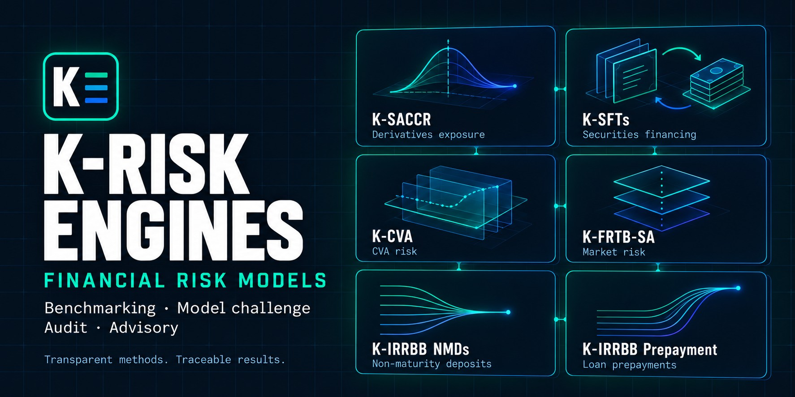
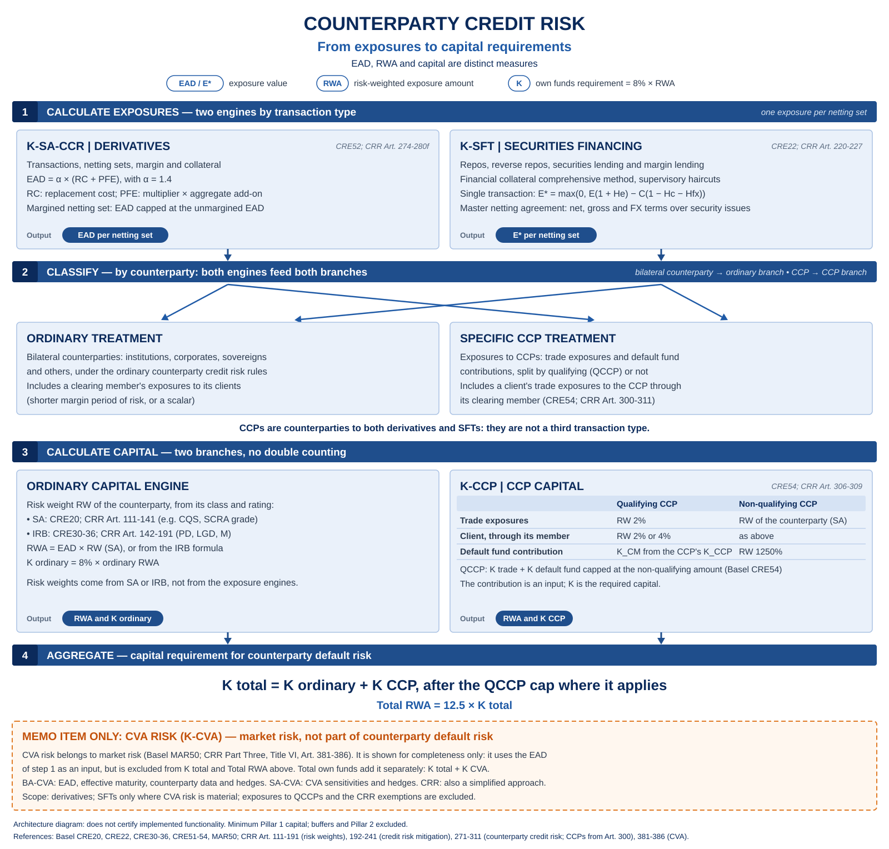
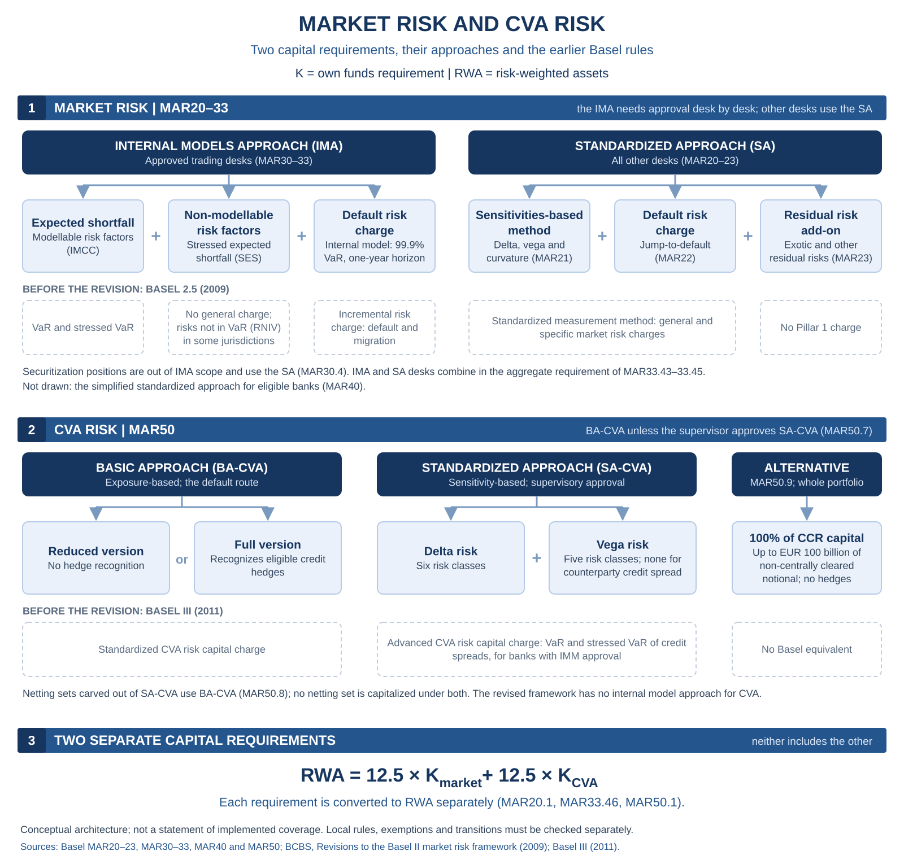

# 🧭 K-Risk Engines

**Transparent methods. Traceable results.**

🌐 [**Visit the website**](https://danielep71.github.io/K-Risk-Engines/) · 📚 [**Project wiki**](https://github.com/danielep71/K-Risk-Engines/wiki)

A single entry point to independent financial risk models and calculation engines for benchmarking, model challenge, audit, advisory and education.

 

 

 

## 🗂️ Explore the portfolio

<!-- portfolio:table:start -->
| Project | Purpose | Project-reported status | Last closed milestone |
| --- | --- | --- | --- |
| [K-SACCR](https://github.com/danielep71/K-SACCR) | SA-CCR calculation and reconciliation | Version 1.0.2 is the current release: the 1.0.2 GitHub Release carries the workbook and the user manual. Latest published release: v1.0.2. [Full status and caveats](docs/PORTFOLIO_STATUS.md#saccr) | [v1.0.2 - Clearing Coverage and CCP Completeness](https://github.com/danielep71/K-SACCR/milestone/14) (2026-10-23) |
| [K-IRRBB NMDs](https://github.com/danielep71/K-IRRBB-NMDs) | Non-maturity deposit behavioural modelling | v0.2.0 – Workbook, data and Excel tests (in progress). No published stable release. [Full status and caveats](docs/PORTFOLIO_STATUS.md#nmd) | [v0.1.0 - Repository foundation](https://github.com/danielep71/K-IRRBB-NMDs/milestone/1) (2026-10-09) |
| [K-FRTB-SA](https://github.com/danielep71/K-FRTB-SA) | Standardized market-risk aggregation | Version 0.2.0 is a prototype of the v0.2.0 — SA prototype milestone (issue #20). No published stable release. [Full status and caveats](docs/PORTFOLIO_STATUS.md#frtb) | [v0.1.0 — Repo setup](https://github.com/danielep71/K-FRTB-SA/milestone/1) (2026-10-18) |
| [K-IRRBB Prepayment Models](https://github.com/danielep71/K-IRRBB-Prepayment_Models) | Behavioural loan prepayment modelling | Current status: specifications only. No published stable release. [Full status and caveats](docs/PORTFOLIO_STATUS.md#prepayment) | [v0.1.0 - Repo setup](https://github.com/danielep71/K-IRRBB-Prepayment_Models/milestone/1) (2026-10-21) |
| [K-SFTs](https://github.com/danielep71/K-SFTs) | Counterparty credit risk for securities financing transactions | Status: working prototype, not a validated method. Latest published release: v0.2.0. [Full status and caveats](docs/PORTFOLIO_STATUS.md#sfts) | [v0.2.0 - Prototype setup](https://github.com/danielep71/K-SFTs/milestone/2) (2026-10-30) |
| [K-CVA](https://github.com/danielep71/K-CVA) | Regulatory CVA risk capital (BA-CVA, then SA-CVA) | Repository setup only. No published stable release. [Full status and caveats](docs/PORTFOLIO_STATUS.md#cva) | None recorded |
| [K-LCR](https://github.com/danielep71/K-LCR) | Liquidity Coverage Ratio (EU and Basel profiles) | Repository setup. No published stable release. [Full status and caveats](docs/PORTFOLIO_STATUS.md#lcr) | None recorded |
<!-- portfolio:table:end -->

The table and [full evidence report](docs/PORTFOLIO_STATUS.md) are generated
snapshots, not live project dashboards. Pinned source links identify the evidence
used; consult the source repositories for changes since the last refresh.

Each repository owns its implementation, methodology, tests, issues and releases. Consult it for current scope, evidence and licensing. This hub contains presentation and portfolio documentation, not calculation code.

### 🏛️ Where the counterparty credit risk calculators belong

The counterparty credit risk calculators of the portfolio fit one framework,
from exposures to capital requirements. [K-SACCR](https://github.com/danielep71/K-SACCR)
produces the exposure value of derivatives and [K-SFTs](https://github.com/danielep71/K-SFTs)
that of securities financing transactions (step 1). The ordinary and CCP
capital branches and their aggregation follow (steps 2 to 4). K-CVA covers CVA
risk, a separate market-risk requirement, shown as a memo item.

[Editable SVG](assets/CCR_framework.svg) · [High-resolution PNG](assets/CCR_framework.png)

This is an architecture diagram, not a status report: it does not certify
implemented functionality. Each engine's repository is the source for its scope
and status, summarised in the table above.

### 📉 Market risk and CVA risk

Market risk and CVA risk are two separate capital requirements, each with its
own approaches. [K-FRTB-SA](https://github.com/danielep71/K-FRTB-SA) addresses
the standardised approach for market risk; [K-CVA](https://github.com/danielep71/K-CVA) addresses CVA risk. The method map below shows both frameworks and
the earlier Basel rules they replace, without project names.

[Editable SVG](assets/Market_risk_framework.svg) · [High-resolution PNG](assets/Market_risk_framework.png)

It is a method map: it does not certify implemented functionality or the scope
of K-FRTB-SA or K-CVA.

### 💧 Liquidity risk

Liquidity risk is the risk that a bank cannot meet its obligations as they fall
due. [K-LCR](https://github.com/danielep71/K-LCR) addresses the Liquidity
Coverage Ratio, which compares the stock of high-quality liquid assets with the
net cash outflows of a 30-day stress period, under separate EU and Basel
profiles. [K-NSFR](https://github.com/danielep71/K-NSFR) addresses the Net
Stable Funding Ratio, which compares available with required stable funding
over a one-year horizon, starting with the EU CRR standard profile. Their
current status is in the portfolio table above.

## 🌐 Website

Project websites: [K-SACCR](https://danielep71.github.io/K-SACCR/) ·
[K-SFTs](https://danielep71.github.io/K-SFTs/) ·
[K-FRTB-SA](https://danielep71.github.io/K-FRTB-SA/) ·
[K-LCR](https://danielep71.github.io/K-LCR/).

The static landing page is `index.html`; images and styles live in [`assets/`](assets/).
It presents the portfolio by risk category (Counterparty Credit Risk, Market
Risk, IRRBB and Liquidity Risk), with the counterparty credit risk and market
risk framework diagrams and a status card for each project. A card links only
to the project's website where it has one (K-SACCR, K-SFTs, K-FRTB-SA, K-LCR),
otherwise to its repository and documentation; detailed documentation and
diagrams stay in each project's repository. Serving it
requires no build step or application dependencies. Repository checks
and automation use Python, curl and GitHub Actions as documented below.

GitHub Pages publishes `main` from the repository root (see
[repository settings](docs/REPOSITORY_SETTINGS.md)). The live website is
[danielep71.github.io/K-Risk-Engines](https://danielep71.github.io/K-Risk-Engines/).

## ✅ Website checks

Run `python3 .github/scripts/check-website.py` from the repository root.
Add `--external` to check external URLs with curl.

The dependency-free check covers explicit HTML tag nesting, document title,
language and doctype, duplicate IDs, image alt attributes, local assets,
CSS `url()` references and internal anchors. It also checks links in every
tracked Markdown file: inline, reference-style, autolinks and HTML `href`/`src`,
outside fenced and inline code. Relative targets must exist inside the
repository, and fragments must match a heading (GitHub's anchor rules) or an
explicit `<a id>`. It is a focused structural check, not a full HTML standards
or accessibility validator. Its own tests run with
`python3 -m unittest discover -s .github/scripts -p 'test_*.py'`.

GitHub Actions runs local checks on every pull request and push to `main`
or a `release/**` branch. External links are checked on pushes, weekly and
on manual runs; redirects are accepted. Broken links fail the check. Network
errors, HTTP 403/429 and server errors are reported as warnings because
availability could not be verified. External page fragments are not validated;
external URLs from Markdown files follow the same rules. Links to this site's own
Pages URLs (`https://danielep71.github.io/K-Risk-Engines/…`) are checked against
the repository files instead, because Pages publishes `main` only.

## 🔄 Daily portfolio refresh

A daily workflow proposes source-attributed status, release and last-closed-milestone updates in a review PR, reused while it stays open. See [operation and review rules](docs/PORTFOLIO_AUTOMATION.md).

## 📈 Traffic history

Daily repository analytics are stored on [`traffic-history`](https://github.com/danielep71/K-Risk-Engines/tree/traffic-history).
See [setup and data definitions](docs/TRAFFIC.md) for the required `analytics`
environment secret, schedules, badges and alerts. This tracks repository traffic,
not GitHub Pages visitors. Clone counts include this repository's own CI
checkouts and maintainer clones, so they do not measure outside interest.

## 🛡️ Governance and security

See [portfolio governance](GOVERNANCE.md) for ownership, project status definitions,
change checks and issue handling, and [repository settings](docs/REPOSITORY_SETTINGS.md)
for the rulesets and other non-default settings. Report vulnerabilities privately under the
[security policy](SECURITY.md). For hub defects and improvements, use the
[issue chooser](https://github.com/danielep71/K-Risk-Engines/issues/new/choose).
The maintainer assigns a milestone and confirms the priority during triage.
Engine calculation and methodology reports belong in their own repositories.

## 🔍 Review approach

1. Align data, scope, conventions and assumptions.
2. Compare intermediate calculations and investigate differences.
3. Record versions, reference results, explanations and unresolved limitations.

Agreement with a benchmark supports a review; it does not by itself establish model validity or regulatory compliance.

## 🗺️ Portfolio direction

Develop the existing projects on their own validation evidence, develop the newer prepayment and K-SFTs projects, and maintain consistent presentation and documentation across the collection. K-CVA, K-LCR and K-NSFR are the newest public projects. Detailed milestones remain in each model repository.

---

## 👤 Maintainer

**Daniele Penza** — [@danielep71](https://github.com/danielep71). This is an
independent personal project.

## 📄 License

[Mozilla Public License 2.0](LICENSE) for the hub's code and documentation.
The portfolio artwork (`assets/K-Risk-Engines-social-preview-v2.jpg`) is
excluded; no separate reuse licence is granted for it. See [licensing and attribution](NOTICE.md).
Each linked engine is licensed separately in its own repository.
