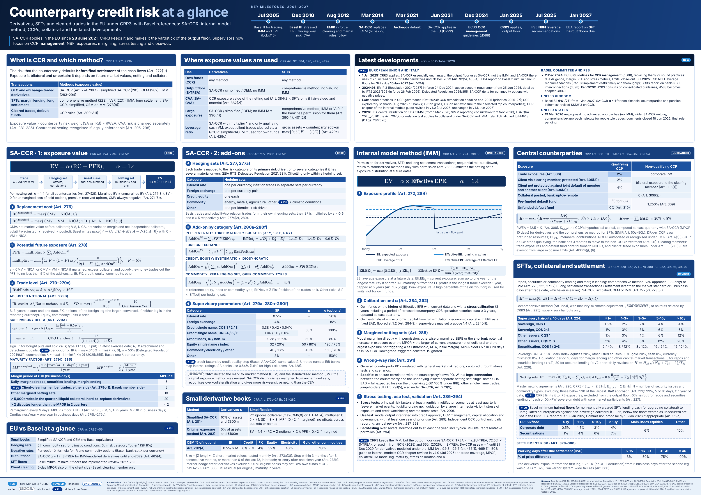

# Counterparty credit risk at a glance

A one-page A0 reference poster on counterparty credit risk (CCR) for
derivatives, securities financing transactions (SFTs) and cleared trades in
the EU under CRR3, with the corresponding Basel references. Status of the
regulatory developments: **30 October 2026**.

[Download the poster (PDF, A0)](../assets/CCR_at_a_glance.pdf) ·
[Preview image (PNG)](../assets/CCR_at_a_glance.png)

## Contents

| Panel | Main references |
| --- | --- |
| What is CCR and which method | CRR Art. 271–273b |
| Where exposure values are used: own funds, output floor, CVA, large exposures, leverage ratio | CRR Art. 92, 384, 390, 429c, 429e |
| SA-CCR 1: exposure value, replacement cost, PFE, adjusted notional, supervisory delta, maturity factor and MPOR | CRR Art. 274–279c · CRE52 |
| SA-CCR 2: hedging sets, add-ons by asset class, supervisory parameters | CRR Art. 277–280f · CRE52 |
| Small derivative books: simplified SA-CCR and original exposure method | CRR Art. 273a–273b, 281–282 |
| EU vs Basel at a glance | CRR vs CRE51–56 |
| Internal model method: Effective EPE, calibration and alpha, margined netting sets, wrong-way risk, stress testing and backtesting | CRR Art. 283–294 · CRE53 |
| Central counterparties: QCCP trade exposures and default fund contributions | CRR Art. 300–311 · EMIR Art. 50a–50c · CRE54 |
| SFTs, collateral and settlement: comprehensive method, supervisory haircuts, master netting, CRE56 haircut floors, settlement risk | CRR Art. 220–227, 271, 378–380 · CRE22, CRE56, CRE70 |
| Latest developments: EU and Italy, Basel Committee and FSB, United Kingdom, United States | Status 30 October 2026 |
| Key milestones, 2005–2027 | bcbs116 to the EBA SFT haircut floor report |

## Use and limits

The poster is a simplified regulatory overview, not legal advice and not a
substitute for the CRR, EMIR, the delegated regulations or the Basel
Framework, which remain authoritative. Developments after its status date
are not reflected.

It is a reference for the CCR domain, not a statement of what the portfolio
implements: [K-SACCR](https://github.com/danielep71/K-SACCR) and
[K-SFTs](https://github.com/danielep71/K-SFTs) document their own scope,
methodology, validation evidence and limitations.
